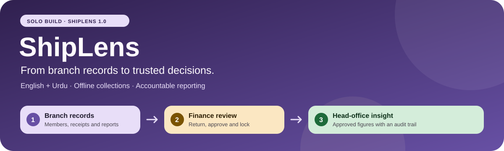
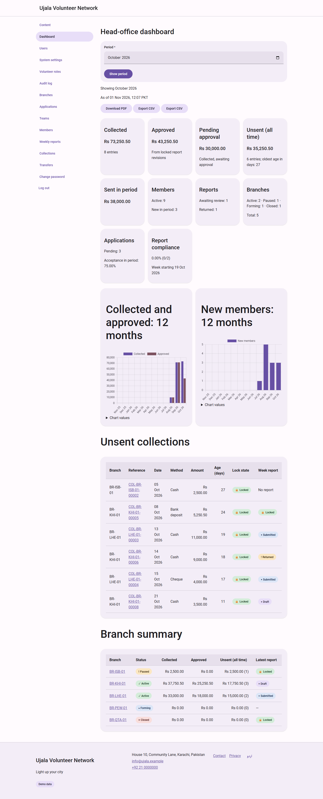
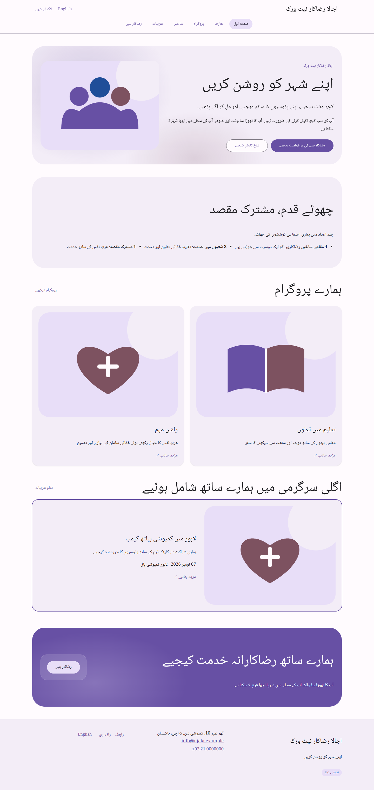

<p align="center">
  
</p>

<p align="center">
  <a href="https://github.com/bilal-rauf-dev/shiplens-branch-platform/actions/workflows/ci.yml"></a>
  <a href="https://shiplens-web.onrender.com"></a>
  
  
  
  <a href="LICENSE"></a>
</p>

# ShipLens

ShipLens connects volunteer branches to head office in one bilingual English/Urdu platform. The public can explore **Ujala Volunteer Network**, a fictional demo organisation, and apply to volunteer; staff can manage branches and members, record **offline** collections and transfers, submit weekly reports, approve and lock figures, and follow every decision through an append-only audit trail. Head office gets fresh dashboard figures on each page load. There are no online payments or WebSocket updates.

**Solo entry for the ShipLens 1.0 build challenge.**

**[🟣 Open the live demo](https://shiplens-web.onrender.com/en/)** · **[اردو](https://shiplens-web.onrender.com/ur/)** · **[Health](https://shiplens-web.onrender.com/health)** · **[Documentation](docs/README.md)** · **[CI runs](https://github.com/bilal-rauf-dev/shiplens-branch-platform/actions/workflows/ci.yml)**

The free Render service can take up to a minute on the first load. Demo data is fictional and shared with other visitors; the reference values below assume a fresh authored seed.

<!-- OWNER: Record the full final judged commit SHA after the final merge and matching deployment. -->
**Submitted version:** owner to record the final SHA.

<!-- OWNER: Insert the coverage percentage (and optional badge) from the final green CI job summary, not a local run. -->
**Coverage:** see the final CI test-job summary; the enforced minimum is 90%.

<!-- OWNER: Add the walkthrough video link: own voice, no more than five minutes. -->
**Walkthrough video:** owner to add the link before submission.

## 🔑 Try all five roles

Sign in at **[Staff login](https://shiplens-web.onrender.com/en/accounts/login/)**. Passwords are **provided in the submission form**.

| Role | Test login | Password | Lands on |
| --- | --- | --- | --- |
| Super Admin | `superadmin.demo@shiplens.test` | provided in the submission form | Head-office dashboard |
| Finance Reviewer | `finance.demo@shiplens.test` | provided in the submission form | Head-office dashboard |
| Content Editor | `content.demo@shiplens.test` | provided in the submission form | Content |
| Branch Lead | `branchlead.demo@shiplens.test` | provided in the submission form | My branch dashboard (Karachi) |
| HR Lead | `hr.demo@shiplens.test` | provided in the submission form | HR overview |

Super Admin does not approve reports or accept applications. Finance reviews reports; assigned HR Leads decide applications. Demo accounts cannot change their passwords or be edited/reset through staff administration. See the generated [permission matrix](docs/permissions.md).

## ⚡ Judge quick path — five steps, under five minutes

Start with a fresh demo seed. Use the logins above and log out between roles. R9 is a sample label, so find the report by its branch and week.

1. **Dashboard · Finance · 45 seconds.** Select **October 2026**. Collected is **Rs 73,250.50 (8 entries)**; Approved is Rs 43,250.50; Awaiting approval is Rs 30,000.00.
2. **Approve R9 · Finance · 60 seconds.** Open Review queue → **BR-LHE-01, 12–18 October 2026**, Submitted, Rs 15,000.00. Choose **Approve and lock**. The report becomes Locked. Refresh the October dashboard: Approved becomes **Rs 58,250.50** and Awaiting becomes **Rs 15,000.00**; Collected stays unchanged.
3. **Seven-day lock · Branch Lead · 45 seconds.** Open Collections and find receipt **C05**, Karachi, 8 October, Rs 5,250.50. It is Locked and unsent, with no edit/void controls. The lock is measured from entry creation time. [Boundary tests](tests/finance/test_lock.py) check one second before and exactly at seven days; nobody can unlock it.
4. **Urdu · 30 seconds.** Open the public home and select **اردو**. Visit Get Involved to see the mirrored form and translated labels; staff pages and PDFs also support Urdu.
5. **Audit · Super Admin · 60 seconds.** Open Audit log. Filter by Lahore and `report.approved`, open R9's approval event, then find `report.locked` for the same report. Check actor, changes and request ID; use **Verify chain** to check integrity. The lock event has a system actor.

The full return/resubmit lifecycle uses **R10: Karachi, week starting 19 October** and is demonstrated by [the lifecycle test](tests/finance/test_report_acceptance.py) and [browser journeys](docs/testing.md). Approving R9 changes the shared demo; the next fresh baseline requires an operator rebuild.

## ✨ What the brief becomes in ShipLens

The IDs below match the deliverables in [the compliance plan](docs/planning/01-compliance-matrix.md).

| Brief | Delivered behavior / evidence |
| --- | --- |
| D-01 · Public website | Home, About, Programs, Branches, Events, Get Involved, Contact, plus Privacy; [public site](docs/public-website.md). |
| D-02 · Volunteer applications | Validated bilingual form, consent, spam controls and duplicate flags; [applications](docs/volunteer-applications.md). |
| D-03 · Login and five roles | Email login, central permissions and branch scope; [generated matrix](docs/permissions.md). |
| D-04 · Branch register | Generated codes, bilingual profiles and guarded lifecycle; [branches](docs/branch-register.md). |
| D-05 · Acceptance to membership | HR acceptance creates exactly one member atomically; [rule catalogue](docs/business-rules.md). |
| D-06 · Member register | Scoped search, combined filters, sorting, pagination, teams and lifecycle; [members](docs/volunteer-applications.md#member-register-and-search). |
| D-07 · Seven-day lock | Exact creation-time boundary, voids and whole-entry offline transfers; [finance](docs/finance.md). |
| D-08 · Weekly reports | Draft → submit → return → resubmit → approve → lock, with snapshots; [reports](docs/weekly-reports.md). |
| D-09 · Head-office insight | October seed totals, twelve-month trends and unsent money; [expected values](docs/planning/09-dashboard-and-seed-data.md#41-reference-period-october-2026). |
| D-10 · Exports | Scoped CSV and weekly/monthly PDF, including Urdu; [exports](docs/exports.md). |
| D-11 · Content manager | Bilingual working copies, preview, published snapshots and sanitization; [content](docs/public-website.md). |
| D-12 · Audit trail | Atomic events, append-only DB guards and a verifiable hash chain; [audit](docs/audit.md). |
| D-13 · English + Urdu | Translated UI, logical CSS, RTL and local fonts; [Urdu guide](docs/i18n-glossary.md). |
| D-14 · Automated tests | PostgreSQL suite with a 90% app-coverage gate; [CI](docs/ci.md). |
| D-15 · GitHub Actions | Lint, tests, security, Docker, E2E, Lighthouse and separate CodeQL; [workflow](.github/workflows/ci.yml). |
| D-16 · Docker + health | Non-root multistage image and DB readiness check; [Dockerfile](Dockerfile), [health contract](docs/openapi.yaml). |
| D-17 · Public source + MIT | [Repository](https://github.com/bilal-rauf-dev/shiplens-branch-platform), [licence](LICENSE); the owner verifies final history/compliance. |
| D-18 · Render + PostgreSQL | [Live demo](https://shiplens-web.onrender.com) and [Blueprint](render.yaml); [operations](docs/handover.md). |
| D-19 · Documentation | Fifteen [ADRs](docs/README.md#architecture-decisions), architecture, generated routes and runbook. |
| D-20 · Test logins | One published login per role in the table above. |
| D-21 · README + AI declaration | This guide and the dated [AI usage log](AI-USAGE.md), maintained by the owner. |
| D-22 · Walkthrough video | Owner-provided recording; link placeholder above. |

## 🖼️ See it in both languages

**Head office — October 2026, fresh local sample data**



**Urdu public home — right-to-left layout**



Also see the existing [Urdu weekly-report PDF example](docs/screenshots/export-report-ur.png). Screenshots contain fictional data; they do not certify the current live deployment.

## 🧭 Architecture and stack choices

`URL → permission + form → service + transaction → model + audit`

Read-only queries live in selectors/KPIs. PostgreSQL constraints and triggers protect identifiers, sent money, locked reports and audit rows. There is one web service and one database; no scheduler is needed. See the [C4 and model diagrams](docs/architecture.md) and [ADRs](docs/README.md#architecture-decisions).

| Choice | Why it fits |
| --- | --- |
| Python 3.12 + Django 5.2 LTS | Forms, sessions, translations and security defaults in one explainable server application. |
| PostgreSQL 16 + psycopg 3 | Exact Decimal money, transactions, row locks, constraints and integrity triggers. |
| Django templates + handwritten MD3 CSS | Small pages, native forms, logical properties for RTL; no frontend build or SPA. |
| Gunicorn + WhiteNoise + Docker | One reproducible non-root runtime with hashed static assets. |
| Argon2, Axes, ratelimit, CSP, Markdown + nh3 | Password hashing, abuse controls and a narrow sanitized content boundary; [security](docs/security.md). |
| WeasyPrint + local Roboto/Naskh; CSV + PyYAML | Urdu PDF shaping, readable local fonts and a portable historical CSV importer with safe header mapping. openpyxl remains in the fixed runtime stack; there is no XLSX import workflow. |
| Vendored Chart.js 4 | Two dashboard charts; public pages ship no scripts. |
| pytest + Playwright + Ruff | PostgreSQL business-rule checks, browser journeys, lint and formatting; [testing](docs/testing.md). |

No React, HTMX, Tailwind or Bootstrap. Detailed [performance evidence](docs/performance.md) and [design rules](docs/design-system.md) have their own guides.

## 🐳 Run locally

Install Docker with Compose support. From a fresh checkout, copy the example; keep any existing `.env`:

```sh
cp .env.example .env
```

Set a long random `SECRET_KEY`. Match `DATABASE_URL` to `POSTGRES_DB`, `POSTGRES_USER` and `POSTGRES_PASSWORD`; the database hostname inside Compose is `db`. Keep secrets in `.env`, which is ignored by Git and excluded from images. Then:

```sh
docker compose up --build
```

Open [English home](http://localhost:8000/en/), [Urdu home](http://localhost:8000/ur/) or [health](http://localhost:8000/health). Development startup migrates, creates the cache table and compiles translations. To stop, use `docker compose down`; the named database volume is retained.

For a non-demo installation, bootstrap an operator with `docker compose exec web python manage.py createsuperuser`. This creates the application's Super Admin role; Django admin is not installed.

### Load the authored sample data

No official sample data was provided; this fictional CSV dataset was authored for the submission. Set `DEMO_MODE=true` and a `DEMO_PASSWORD` of at least twelve characters in `.env`, recreate the web container to load the updated environment, then run:

```sh
docker compose exec web python manage.py seed_demo --reset
```

This intentionally replaces demo domain data, settings overrides, sessions and audit history. It is refused outside demo mode. It is an **operator command**, with no HTTP reset button or route. The [sample-data guide](sample_data/README.md) describes the CSVs and alternative header mapping. The [handover guide](docs/handover.md#rebuild-the-live-fictional-demo) gives the live-DB operator procedure.

For a fresh seed in October 2026: Collected **Rs 73,250.50**, Approved **Rs 43,250.50**, Awaiting **Rs 30,000.00**, all-time Unsent **Rs 35,250.50 (6 entries)**, October Sent **Rs 38,000.00**. [All expected values](docs/planning/09-dashboard-and-seed-data.md#41-reference-period-october-2026) use 31 October 2026, 23:00 PKT; ages and compliance change with the business date.

Production startup seeds with `--if-empty`; later redeployments preserve demonstration changes. Development Compose requires the explicit command above.

## 🧪 Run the checks

The ordinary suite uses PostgreSQL, never SQLite, and excludes E2E/visual cases. With local Compose running, this disposable development runner installs test tools without adding them to the production image:

```sh
docker compose run --rm --user root --env DJANGO_SETTINGS_MODULE=config.settings.test web sh -c 'python -m pip install --require-hashes -r requirements.txt -r requirements-dev.txt && ruff check . && ruff format --check . && python bin/check_conventions.py && pytest --cov=apps --cov-report=term-missing --cov-fail-under=90'
```

In a Python environment with the locked development dependencies and Chromium installed, use these commands after the environment/target setup in [the browser guide](docs/testing.md):

```sh
# Separately started, disposable seeded production stack; BASE_URL and DEMO_PASSWORD set.
pytest tests/e2e -m e2e --browser chromium --no-cov --tracing retain-on-failure --screenshot only-on-failure

# Local PostgreSQL test DB + installed Chrome; captures local live_server screenshots.
pytest tests/visual -m visual --browser-channel chrome --no-cov
```

E2E advances R10, so rebuild only its disposable seed before repeating the full journey. Remote E2E permits read-only journeys plus login. Follow [testing](docs/testing.md) for setup, traces and Lighthouse; [CI](docs/ci.md) for coverage and security checks.

## 🚀 Deploy and operate

Use [render.yaml](render.yaml) as a Render Blueprint: Docker web service and PostgreSQL 16 in Singapore. The owner connects the repository's `main`, supplies `DEMO_PASSWORD`, waits for checks/deploy, then checks HTTPS, both languages, all five logins and `/health` against the deployed commit. Startup runs migrations before Gunicorn. Auto-deploy is configured for **After CI Checks Pass**; external service settings still need operator verification.

| Environment value | Purpose |
| --- | --- |
| `SECRET_KEY` | Local random signing key; generated by the Render Blueprint. |
| `DATABASE_URL` | PostgreSQL URL; local `db` service or linked Render private URL. Production defaults to TLS. |
| `DJANGO_SETTINGS_MODULE` | `config.settings.dev` locally; `config.settings.prod` on Render; `config.settings.test` for tests. |
| `DJANGO_ALLOWED_HOSTS` | Comma-separated hostnames without schemes or ports. |
| `CSRF_TRUSTED_ORIGINS` | Comma-separated origins including scheme. |
| `RENDER_EXTERNAL_HOSTNAME` | Added automatically to allowed hosts and HTTPS CSRF origins. |
| `TRUSTED_PROXY_HOPS` | Right-counted forwarded entries; Render default 1, direct deployment 0. |
| `DEMO_MODE`, `DEMO_PASSWORD` | Enable guarded demo setup; the password is set manually and never stored in CSVs. |
| `WEB_CONCURRENCY`, `PORT`, `LOG_LEVEL` | Gunicorn worker count (Blueprint: 2), listener and operational log level. |
| `RENDER_GIT_COMMIT`, `GIT_SHA` | Render version or image-build fallback for the short health version. |
| `POSTGRES_DB`, `POSTGRES_USER`, `POSTGRES_PASSWORD` | Development Compose database configuration. |

The [handover runbook](docs/handover.md) covers password rotation, CLI rebuilds, database expiry/replacement, `pg_dump` backups, restore, administration and incidents. Changing the environment password and redeploying alone does **not** change existing demo hashes.

## 📚 Limits, credits and ownership

The release has no online payments, outbound email, file uploads or adjustment-entry workflow. Interest choices are fixed; weeks start on Monday. Historical active-member counts use current status. Member/unsent counts in the branch register remain placeholders; use the dashboard and operational lists for actual figures. Free hosting can cold-start, and its database needs an expiry plan. See the [runbook](docs/handover.md#known-limitations-and-deferred-work), [security boundaries](docs/security.md) and [implementation differences](docs/business-rules.md#differences-from-the-earlier-plan).

AI assistance is declared in **[AI-USAGE.md](AI-USAGE.md)**. The owner maintains that dated log and reviews the implementation for the solo challenge's explainability requirement.

Thanks to Django, PostgreSQL, WeasyPrint, Chart.js, the Roboto and Noto font projects, axe-core and the other maintainers listed in **[credits and generated licences](docs/credits.md)**. Source code is **[MIT licensed](LICENSE)**; third-party components retain their licences.

<!-- OWNER: Replace the existing copyright-holder placeholder in LICENSE before submission. -->
