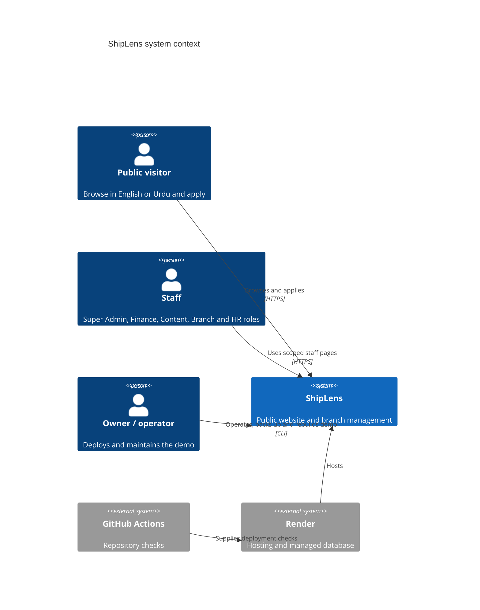
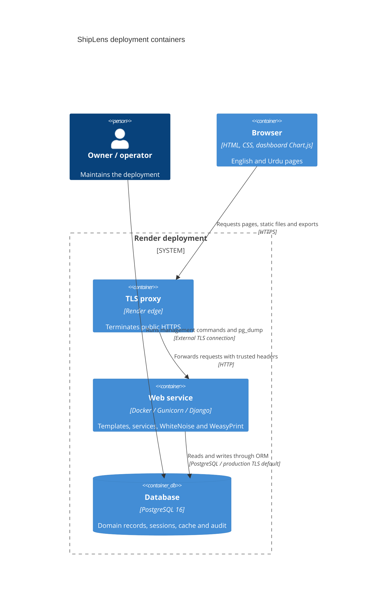
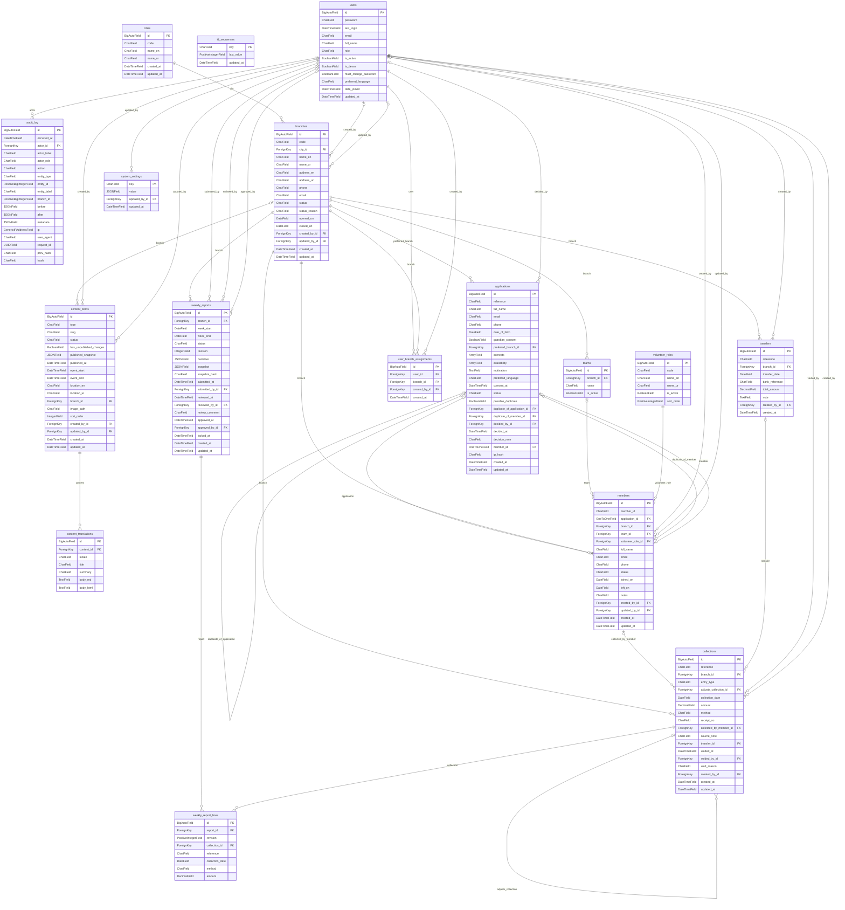

# Architecture

ShipLens is one Django application for public visitors and five staff roles.
Ujala Volunteer Network is the fictional demonstration organisation. Pages are
server rendered; dashboard figures refresh on page load. Collections and transfers
record offline activity. There is no payment provider, SPA or background worker.
The [ADRs](adr/0001-django-monolith.md) explain the main choices.

## C4 context

## C4 containers

WhiteNoise and WeasyPrint are libraries inside the web container, not independent
services. DatabaseCache shares rate limits across workers. No Redis is required.
The [deployment runbook](handover.md) describes operating the containers.

## Module map

| App | Responsibility |
| --- | --- |
| `core` | Clock, rule overrides, ID counters, middleware, shared forms, health and template helpers. |
| `accounts` | Email identity, sessions, central permissions, branch assignments and user/settings administration. |
| `branches` | Cities, branch codes, scoped register and branch lifecycle. |
| `volunteers` | Applications, spam guards, HR decisions, members, teams and volunteer roles. |
| `finance` | Offline collections, transfers, weekly report drafting, snapshots and review. |
| `dashboard` | Read-only KPI queries, period selection, role dashboards and chart data embedded in HTML. |
| `cms` | Working translations, sanitized Markdown and published content snapshots. |
| `publicsite` | Public selectors, pages, metadata, sitemap and robots; included through URL configuration. |
| `exports` | Scoped CSV and PDF generation, shared limits and export auditing. |
| `audit` | Request context, append-only history, hash verification and Super Admin viewer. |
| `seed` | CSV historical replay, guarded demo setup and operator-only rebuild. |

`config/` holds split settings, URL configuration and WSGI. `publicsite` has no
models or separate `INSTALLED_APPS` entry. See [permissions](permissions.md),
[security](security.md), [exports](exports.md), [public content](public-website.md),
[performance](performance.md), [CI](ci.md), [audit](audit.md) and the
[Urdu guide](i18n-glossary.md) for those concerns.

## Request lifecycle

Incoming middleware order below is copied from `config/settings/base.py`.
Responses unwind in reverse order; `process_view` runs after URL resolution.

1. `apps.core.middleware.RequestIdMiddleware` — validated UUID and request-local rules/assignment snapshots.
2. `csp.middleware.CSPMiddleware`.
3. `apps.core.middleware.SecurityHeadersMiddleware`.
4. `apps.core.middleware.HealthCheckMiddleware` — `/health` short-circuits here.
5. `django.middleware.security.SecurityMiddleware`.
6. `whitenoise.middleware.WhiteNoiseMiddleware` — serves static assets directly.
7. `django.contrib.sessions.middleware.SessionMiddleware`.
8. `django.middleware.locale.LocaleMiddleware`.
9. `django.middleware.common.CommonMiddleware`.
10. `django.contrib.auth.middleware.AuthenticationMiddleware`.
11. `apps.audit.middleware.AuditContextMiddleware`.
12. `apps.accounts.middleware.SessionTimeoutMiddleware`.
13. `apps.core.middleware.RouteRegistryMiddleware`.
14. `apps.accounts.middleware.MustChangePasswordMiddleware`.
15. `django.middleware.csrf.CsrfViewMiddleware`.
16. `django.contrib.messages.middleware.MessageMiddleware`.
17. `django.middleware.clickjacking.XFrameOptionsMiddleware`.
18. `axes.middleware.AxesMiddleware`.

The resolver chooses a view. The route registry allows explicitly public names,
looks up protected names in `ROUTE_ACTIONS`, and rejects unregistered names with
404. Anonymous private requests redirect to login; disallowed roles get 403.
Views validate forms and use scoped selectors before object lookup. Out-of-scope
identifiers return 404. Services recheck permissions, take transaction/row locks,
enforce state rules, write the change and call `audit.record` in the same transaction.
Templates render the result; successful form writes normally redirect. Validation
and state conflicts normally return 400 and 409. The route reference records methods.

For example, Finance approval locks the branch then report, verifies status and
revision, records `report.approved`, changes to Locked and records `report.locked`.
Both changes commit together. The second event has a system actor. The next
dashboard request reads the approved revision's stored lines.

The health shortcut runs before sessions, host validation and HTTPS redirects so
internal HTTP/IP readiness probes work. Its outer request-ID, CSP and security
header layers still apply. See [security](security.md) for the boundaries.

## ER diagram from the real models

Generated by `python bin/export_model_diagram.py` with the normal Django environment
configured; no database connection is needed. The script reads concrete Django
model metadata, including inherited fields, from every `apps/*/models.py` model.
Each block includes all stored fields; each relationship is labelled with its field
name. Nullable links use an optional parent end; one-to-one links have at most one
child. `AuditLog.branch_id` and entity identifiers are scalar history identifiers,
not FKs. Framework sessions, auth/content types and Axes models are outside this
application-model diagram; DatabaseCache is a command-created table, not a model.

<!-- ER:START -->

<!-- ER:END -->

## Schema protections and plan differences

Read model `Meta.constraints` and migrations together: branch/member identity,
same-branch team membership, sent collections, transfers, locked reports/lines
and audit history have migration-level guards as well as service checks.
The [business-rule catalogue](business-rules.md) names the enforcement and tests.

Compared with planning/10 and planning/18: `/health` is the only machine endpoint;
charts receive JSON embedded in HTML, and draft generation uses pages or a command.
There is no `/internal/generate-drafts` or dashboard JSON API. There is no generic
`services/` package: apps mostly use `services.py`, with finance report modules
alongside it. No scheduler or outbound notification hook is required. Identifiers
use ORM `get_or_create` and locked counters, not a raw SQL counter upsert.
