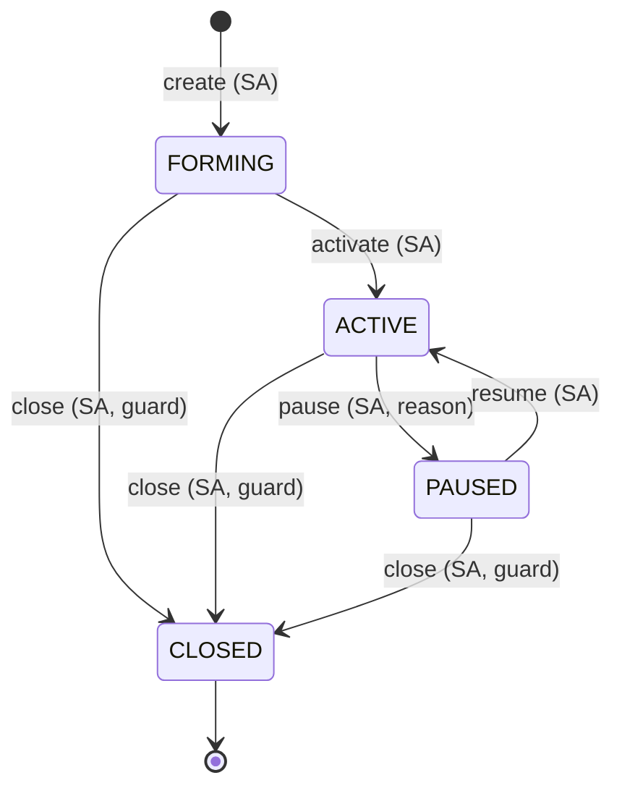
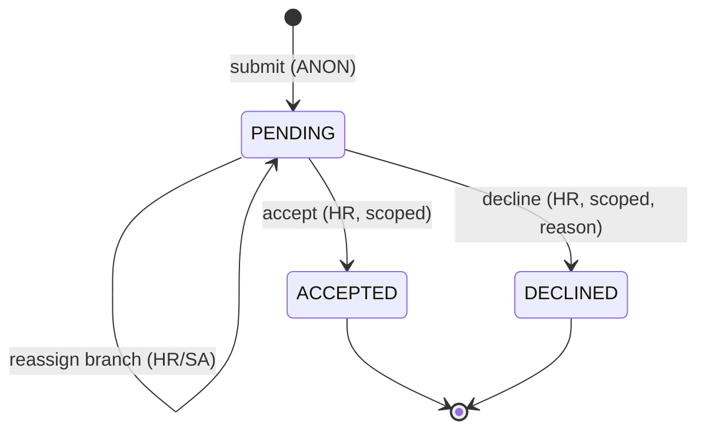
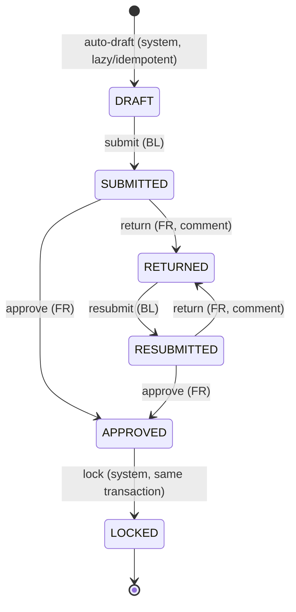
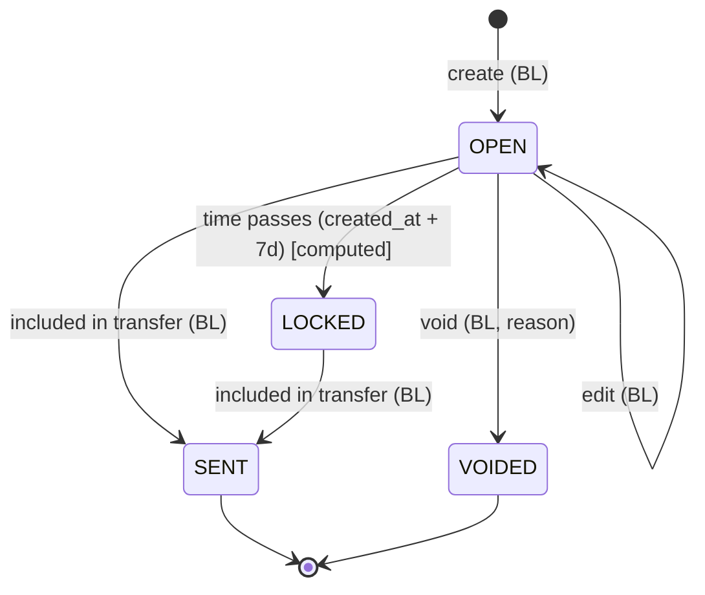
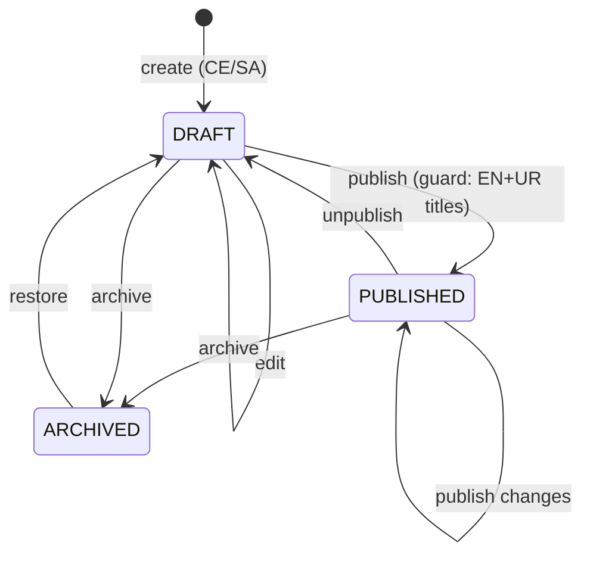
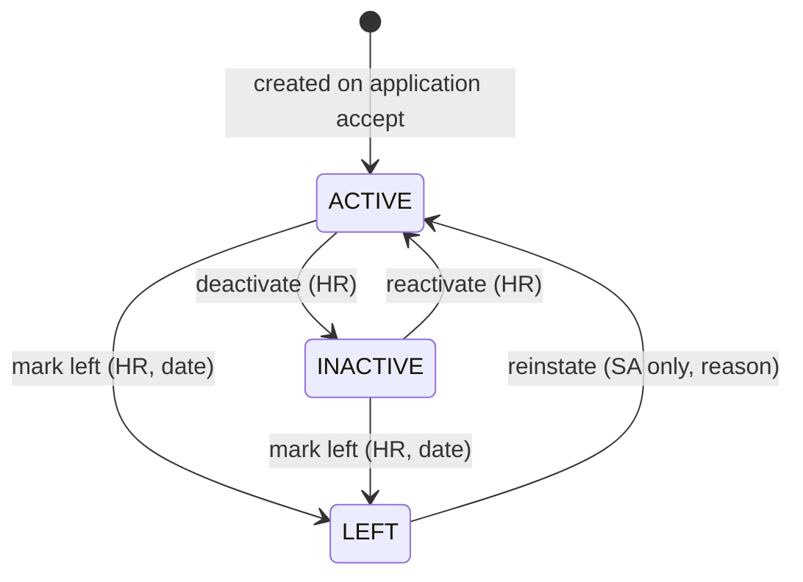

# 06 — State Machines

**Implementation pattern (all entities):** a plain transition table in the entity's `services.py`, no FSM library — easy to explain and to extend for a twist.

```python
# illustrative only
REPORT_TRANSITIONS = {
    # (from_state, action): (to_state, required_permission, guard_fn)
    ("DRAFT", "submit"):      ("SUBMITTED",   "report.submit",   guard_narrative_complete),
    ("SUBMITTED", "return"):  ("RETURNED",    "report.return",   guard_comment_present),
    ...
}
def transition(actor, obj, action, **kw):  # one function: check table -> permission -> guard
    ...                                    # -> select_for_update -> mutate -> audit -> commit
```

Each transition runs in **one DB transaction**: lock row (`SELECT … FOR UPDATE`), verify current state still matches (prevents double-approve races), apply side effects, write audit row(s). Invalid transitions raise `InvalidTransition` → HTTP 409.

---

## 1. Branch lifecycle



| Transition | Role | Preconditions | Side effects | Audit event |
|---|---|---|---|---|
| create | SA | city exists; name unique within city | code `BR-{CITY}-{NN}` generated; status FORMING | `branch.created` |
| activate | SA | status FORMING | `opened_on` = today (PKT); weekly drafts start from this week | `branch.activated` |
| pause | SA | ACTIVE; reason required | collections blocked; no new drafts; public badge | `branch.paused` |
| resume | SA | PAUSED | collections allowed again | `branch.resumed` |
| close | SA | not CLOSED; 0 unsent collections; 0 reports in SUBMITTED/RESUBMITTED/RETURNED; reason | `closed_on` set; hidden publicly; assignments kept for history but inactive | `branch.closed` |

## 2. Application



| Transition | Role | Preconditions | Side effects | Audit |
|---|---|---|---|---|
| submit | ANON | valid form, spam checks pass, branch Active/Forming | ref `APP-YYYY-NNNNN`; duplicate flag computed | `application.submitted` (actor = anonymous, IP hashed) |
| reassign | HR (source application's branch in scope; target any Active/Forming branch) / SA | PENDING; target branch Active/Forming | preferred_branch changed | `application.reassigned` |
| accept | HR | PENDING (re-checked under row lock); branch not Closed | **Member created** with `M-YYYY-NNNNN`, status ACTIVE, team/role from dialog; `application.member_id` set | `application.accepted` + `member.created` |
| decline | HR | PENDING; reason 5–500 chars | none | `application.declined` |

## 3. Weekly report (Gate 2)



| Transition | Role | Preconditions | Side effects | Audit |
|---|---|---|---|---|
| auto-draft | system (triggered by BL page view, dashboard, or command) | branch **currently** ACTIVE (paused/closed branches get no new drafts); week starts on/after `opened_on`; week ended or current; none exists for (branch, week) | row with status DRAFT, revision 0, figures computed live | `report.drafted` (actor = system) |
| submit | BL (scoped) | DRAFT; week has ended (Sunday 23:59 PKT passed) — *configurable `ALLOW_SUBMIT_CURRENT_WEEK`, default false*; required narrative fields filled | revision = 1; **snapshot**: totals JSON + `weekly_report_lines` copied from collections; `snapshot_hash`; week becomes **closed** for collection edits | `report.submitted` |
| return | FR | SUBMITTED or RESUBMITTED; comment 5–1000 chars; `expected_revision` matches | week re-opened for corrections (7-day lock still applies per entry) | `report.returned` (comment in `after`) |
| resubmit | BL | RETURNED; narrative valid | revision += 1; new snapshot replaces lines (old lines retained in audit `before`) | `report.resubmitted` |
| approve | FR | SUBMITTED or RESUBMITTED; `expected_revision` matches | `approved_at/by` set | `report.approved` |
| lock | system, in the same transaction as approve | APPROVED | `locked_at` set; DB trigger now rejects any UPDATE of the row or its lines | `report.locked` |

**Why APPROVED and LOCKED are separate states even though they happen together:** the brief's gate lists "approve → lock" as two steps; two audit events make each step visible, and if a twist asks for "lock after 24 h" or "Super Admin locks", only the trigger of the `lock` transition changes.

## 4. Collection entry



`state` is **derived**, not stored: `VOIDED` if `voided_at`; else `SENT` if `transfer_id`; else `LOCKED` if `now ≥ created_at + lock_days`; else `OPEN`. A second, orthogonal condition **week closed** (report SUBMITTED/RESUBMITTED/APPROVED/LOCKED for that branch-week) also blocks edit/void.

| Transition | Role | Preconditions | Audit |
|---|---|---|---|
| create | BL | branch ACTIVE; date in `[today−lock_days, today]`; week not closed; receipt no. unique in branch | `collection.created` |
| edit | BL | OPEN; week not closed; not SENT | `collection.updated` (before/after diff) |
| void | BL | OPEN; week not closed; not SENT; reason | `collection.voided` |
| lock | (time) | — | none (not a change); denied attempts → `collection.edit_denied` |
| send | BL | not VOIDED, not SENT; same branch | `transfer.created` + `collection.sent` per entry |

## 5. Content item



| Transition | Side effects | Audit |
|---|---|---|
| publish | copies working translations into `published_snapshot` JSON; `published_at` | `content.published` |
| edit while published | working copy only; `has_unpublished_changes = true` | `content.updated` |
| unpublish / archive / restore | public site stops/starts showing | `content.unpublished` / `content.archived` / `content.restored` |

## 6. Member status



| Transition | Side effects | Audit |
|---|---|---|
| deactivate/reactivate | counts in KPIs change | `member.status_changed` |
| mark left | `left_on` set; email/phone released for re-application dedupe | `member.status_changed` |
| reinstate | `left_on` cleared | `member.reinstated` |
