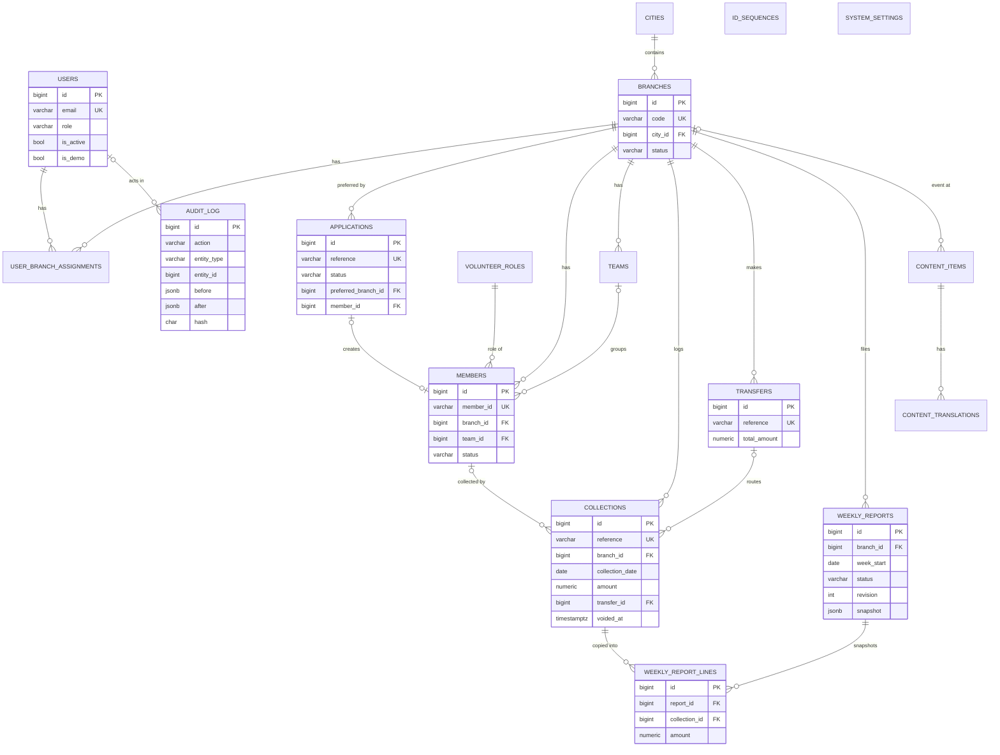

# 08 — Data Model (PostgreSQL 16)

## 1. Key decisions

| Topic | Decision | Reason | Trade-off |
|---|---|---|---|
| Primary keys | `BIGINT GENERATED BY DEFAULT AS IDENTITY` (Django `BigAutoField`) | Simple, fast, explainable. IDOR handled by scoped queries, not by unguessable ids. | Sequential ids visible in URLs (harmless when every lookup is scoped → 404). |
| Business identifiers | Separate immutable code columns (`branch.code`, `member.member_id`, refs) | Humans use codes; PK stays internal. | Extra counter table. |
| Money | `NUMERIC(12,2)` + Python `Decimal`; currency PKR implicit | Exact arithmetic; no float errors. | Up to 9,999,999,999.99 — ample. |
| Enums | `VARCHAR(20)` + `CHECK (col IN (...))` (Django `TextChoices` + `CheckConstraint`) | Readable in SQL and audit; easy to extend (new state = migration of check). | — |
| Translations (operational) | `name_en`, `name_ur` columns on branches/cities/roles | Few fields, simple queries. | New language needs a migration (~30 min). |
| Translations (CMS) | `content_translations(content_id, locale, …)` table | Per-locale content, new language without migration. | One join. |
| Soft delete | No generic soft delete. Collections → `voided_at`; users → `is_active=false`; branches → CLOSED; content → ARCHIVED. **No hard deletes from the UI anywhere.** | Accountability. | — |
| Timestamps | `created_at`, `updated_at` (timestamptz, UTC) on every table; `created_by_id`/`updated_by_id` on domain tables | Audit convenience. | — |
| Report immutability | Snapshot JSON + copied line items at submit; DB trigger when LOCKED | Later changes can't alter approved totals. | Duplication by design. |
| Audit tamper resistance | Append-only trigger + hash chain | See §4. | Advisory lock serialises audit writes (fine at this scale). |

## 2. ER diagram

## 3. Tables

### 3.1 `users` (custom Django user — `AUTH_USER_MODEL = accounts.User`)
| Column | Type | Constraints |
|---|---|---|
| id | bigint | PK |
| email | varchar(254) | NOT NULL; unique index on `lower(email)` |
| full_name | varchar(100) | NOT NULL |
| password | varchar(128) | Argon2id hash |
| role | varchar(20) | CHECK in (SUPER_ADMIN, FINANCE_REVIEWER, CONTENT_EDITOR, BRANCH_LEAD, HR_LEAD) |
| is_active | bool | default true |
| is_demo | bool | default false (demo accounts: password locked, resettable) |
| must_change_password | bool | default false |
| preferred_language | varchar(5) | CHECK in (en, ur) |
| last_login, date_joined, updated_at | timestamptz | |
No `is_staff`/`is_superuser` usage (Django admin disabled in prod).

### 3.2 `cities`
id PK · code char(3) UNIQUE CHECK `~ '^[A-Z]{3}$'` · name_en varchar(60) · name_ur varchar(60) · timestamps.

### 3.3 `branches`
| Column | Type | Constraints |
|---|---|---|
| id | bigint | PK |
| code | varchar(16) | UNIQUE, NOT NULL, immutable (trigger) |
| city_id | bigint | FK cities RESTRICT |
| name_en / name_ur | varchar(100) | NOT NULL; unique `(city_id, lower(name_en))` |
| address_en / address_ur | varchar(250) | |
| phone | varchar(16) | E.164 |
| email | varchar(254) | |
| status | varchar(10) | CHECK in (FORMING, ACTIVE, PAUSED, CLOSED) |
| status_reason | varchar(300) | |
| opened_on / closed_on | date | CHECK closed_on ≥ opened_on |
| created_by_id, updated_by_id | FK users | |
| created_at / updated_at | timestamptz | |
Indexes: `(status)`.

### 3.4 `user_branch_assignments`
id PK · user_id FK CASCADE? **RESTRICT** · branch_id FK RESTRICT · created_at · created_by_id · UNIQUE(user_id, branch_id). (Check user role ∈ {BRANCH_LEAD, HR_LEAD} in service.)

### 3.5 `id_sequences`
key varchar(40) PK (e.g. `branch:KHI`, `member:2026`, `application:2026`, `collection:BR-KHI-01`) · last_value int NOT NULL default 0 · updated_at.
Usage: `SELECT last_value FROM id_sequences WHERE key=%s FOR UPDATE` → +1 → UPDATE, inside the business transaction (row created with `INSERT … ON CONFLICT DO NOTHING` first).

### 3.6 `applications`
| Column | Type | Constraints |
|---|---|---|
| id | bigint | PK |
| reference | varchar(16) | UNIQUE |
| full_name | varchar(100) | NOT NULL |
| email | varchar(254) | NOT NULL (stored lower-case); index |
| phone | varchar(16) | NOT NULL E.164; index |
| date_of_birth | date | NOT NULL |
| guardian_consent | bool | |
| preferred_branch_id | bigint | FK branches |
| interests | varchar(40)[] | |
| availability | varchar(20)[] | |
| motivation | text | CHECK length 20–1000 |
| preferred_language | varchar(5) | |
| consent_at | timestamptz | NOT NULL |
| status | varchar(10) | CHECK in (PENDING, ACCEPTED, DECLINED) |
| possible_duplicate | bool | default false |
| duplicate_of_application_id / duplicate_of_member_id | bigint | nullable FKs |
| decided_by_id | FK users | |
| decided_at | timestamptz | |
| decision_note | varchar(500) | required when DECLINED (CHECK) |
| member_id | bigint | FK members UNIQUE nullable; CHECK `(status='ACCEPTED') = (member_id IS NOT NULL)` |
| ip_hash | char(64) | sha256(ip + secret) — abuse analysis without storing raw IP |
| created_at / updated_at | timestamptz | |
Indexes: `(preferred_branch_id, status, created_at desc)`.

### 3.7 `volunteer_roles`
id · code varchar(30) UNIQUE · name_en · name_ur · is_active · sort_order.

### 3.8 `teams`
id · branch_id FK · name varchar(60) · is_active · UNIQUE(branch_id, lower(name)) · UNIQUE(id, branch_id) (for composite FK).

### 3.9 `members`
| Column | Type | Constraints |
|---|---|---|
| id | bigint | PK |
| member_id | varchar(16) | UNIQUE, immutable |
| application_id | bigint | FK UNIQUE nullable (null for imported) |
| branch_id | bigint | FK |
| team_id | bigint | nullable; composite FK `(team_id, branch_id)` → `teams(id, branch_id)` |
| volunteer_role_id | bigint | FK |
| full_name, email, phone | | as applications |
| status | varchar(10) | CHECK in (ACTIVE, INACTIVE, LEFT) |
| joined_on | date | NOT NULL |
| left_on | date | CHECK (status='LEFT') = (left_on IS NOT NULL); left_on ≥ joined_on |
| notes | varchar(1000) | |
| timestamps, created_by/updated_by | | |
Indexes: `(branch_id, status)`, `lower(full_name)` trigram optional (OPT), partial unique `lower(email) WHERE status <> 'LEFT'`.

### 3.10 `collections`
| Column | Type | Constraints |
|---|---|---|
| id | bigint | PK |
| reference | varchar(24) | UNIQUE |
| branch_id | bigint | FK |
| entry_type | varchar(12) | CHECK in (COLLECTION, ADJUSTMENT) default COLLECTION |
| adjusts_collection_id | bigint | FK self nullable; CHECK (entry_type='ADJUSTMENT') = (adjusts_collection_id IS NOT NULL) |
| collection_date | date | NOT NULL |
| amount | numeric(12,2) | CHECK (entry_type='ADJUSTMENT' OR amount > 0) AND amount <> 0 |
| method | varchar(14) | CHECK in (CASH, CHEQUE, BANK_DEPOSIT) |
| receipt_no | varchar(30) | UNIQUE(branch_id, receipt_no) |
| collected_by_member_id | bigint | FK members nullable |
| source_note | varchar(200) | e.g. "Friday mosque box" — no donor PII required |
| transfer_id | bigint | FK transfers nullable |
| voided_at / voided_by_id / void_reason | | CHECK all-or-none |
| created_by_id | FK users | NOT NULL |
| created_at / updated_at | timestamptz | |
Indexes: `(branch_id, collection_date)`, partial `(branch_id, collection_date) WHERE transfer_id IS NULL AND voided_at IS NULL` (unsent list).
Trigger: reject UPDATE of amount/date/method/branch when `OLD.transfer_id IS NOT NULL`.
Lock is computed (`created_at + lock_days`), no column.

### 3.11 `transfers`
id · reference UNIQUE · branch_id FK · transfer_date date · bank_reference varchar(50) NOT NULL · total_amount numeric(12,2) CHECK > 0 · note · created_by_id · created_at. Immutable (no update path; trigger blocks UPDATE).

### 3.12 `weekly_reports`
| Column | Type | Constraints |
|---|---|---|
| id | bigint | PK |
| branch_id | bigint | FK |
| week_start | date | CHECK isodow = 1 |
| week_end | date | CHECK week_end = week_start + 6 |
| status | varchar(12) | CHECK in (DRAFT, SUBMITTED, RETURNED, RESUBMITTED, APPROVED, LOCKED) |
| revision | int | default 0, CHECK ≥ 0 |
| narrative | jsonb | keys from `REPORT_FIELDS` |
| snapshot | jsonb | aggregates + lines at last submit |
| snapshot_hash | char(64) | |
| submitted_at / submitted_by_id | | |
| reviewed_at / reviewed_by_id / review_comment | | latest review |
| approved_at / approved_by_id / locked_at | | CHECK (status='LOCKED') = (locked_at IS NOT NULL) |
| created_at / updated_at | | |
UNIQUE(branch_id, week_start). Index `(status)`, `(week_start)`.
Trigger `weekly_reports_lock_guard`: `IF OLD.status = 'LOCKED' THEN RAISE EXCEPTION 'report locked'`.

### 3.13 `weekly_report_lines`
id · report_id FK · revision int · collection_id FK · reference · collection_date · method · amount numeric(12,2) · UNIQUE(report_id, revision, collection_id).
On resubmit, lines for the new revision are inserted; dashboards read lines where `revision = report.revision`. Trigger blocks UPDATE/DELETE when parent LOCKED.

### 3.14 `content_items`
id · type varchar(16) CHECK in (PAGE_SECTION, PROGRAM, EVENT) · slug varchar(80) · UNIQUE(type, slug) · status CHECK in (DRAFT, PUBLISHED, ARCHIVED) · has_unpublished_changes bool · published_snapshot jsonb (`{"en": {...}, "ur": {...}, "meta": {...}}`) · published_at · event_start / event_end timestamptz (CHECK end ≥ start) · location_en/ur · branch_id FK nullable · image_path varchar(200) (static asset chosen from a list — no uploads in MVP) · sort_order · created_by/updated_by · timestamps.

### 3.15 `content_translations`
id · content_id FK CASCADE · locale varchar(5) · title varchar(150) · summary varchar(300) · body_md text · body_html text (sanitised) · UNIQUE(content_id, locale).

### 3.16 `audit_log`
| Column | Type | Notes |
|---|---|---|
| id | bigint | PK |
| occurred_at | timestamptz | default now() |
| actor_id | bigint | FK users nullable (system/anon) ON DELETE SET NULL — users are never deleted anyway |
| actor_label | varchar(254) | email / "system" / "anonymous" |
| actor_role | varchar(20) | |
| action | varchar(60) | e.g. `report.approved` |
| entity_type | varchar(40) | |
| entity_id | bigint | |
| entity_label | varchar(120) | e.g. `BR-KHI-01 · 2026-W42` |
| branch_id | bigint | for scoping/filtering |
| before / after | jsonb | changed fields only + identifiers |
| metadata | jsonb | e.g. export filters, row count, reason |
| ip | inet | from `X-Forwarded-For` first hop (Render proxy) |
| user_agent | varchar(200) | truncated |
| request_id | uuid | from middleware (`X-Request-ID`) |
| prev_hash / hash | char(64) | chain |
Indexes: `(entity_type, entity_id, occurred_at)`, `(occurred_at desc)`, `(actor_id)`, `(action)`, `(branch_id, occurred_at)`.
Triggers: `BEFORE UPDATE OR DELETE` → RAISE; `BEFORE TRUNCATE` → RAISE.

### 3.17 `system_settings`
key varchar(50) PK · value jsonb · updated_by_id · updated_at. Keys: `collection_lock_days`, `allow_submit_current_week`, `min_volunteer_age`, `apply_rate_per_hour`.

### 3.18 Framework tables
`django_session` (server-side sessions), `django_cache_table` (DatabaseCache for ratelimit), `axes_accessattempt` / `axes_accesslog` (login lockout), `django_migrations`.

## 4. Tamper-resistant auditing (explained for judges)

1. **Single write path:** services call `audit.record()` inside the same transaction as the change — if the change commits, the audit row commits; if it rolls back, neither exists.
2. **Append-only at DB level:** triggers raise on UPDATE/DELETE/TRUNCATE of `audit_log`. Even a bug or SQL injection through the app role cannot rewrite history. (On Render the app uses the DB owner role, which *could* drop the trigger with DDL — documented limitation; in a real deployment we'd use a separate non-owner app role with `REVOKE UPDATE, DELETE`.)
3. **Hash chain:** each row stores `hash = sha256(prev_hash + canonical JSON of the row)`. `manage.py verify_audit_chain` (and a button for SA) recomputes the chain and reports the first broken link. Writes are serialised with `pg_advisory_xact_lock` so two concurrent transactions can't fork the chain.
4. **Reports:** snapshot + lines + `snapshot_hash` make an approved report independently verifiable.

## 5. Migration & seed policy
- Django migrations only; `RunSQL` for triggers (with reverse SQL).
- `makemigrations --check` in CI prevents un-committed model changes.
- Seeds are management commands, never migrations (except reference data: roles list, cities via data migration).
