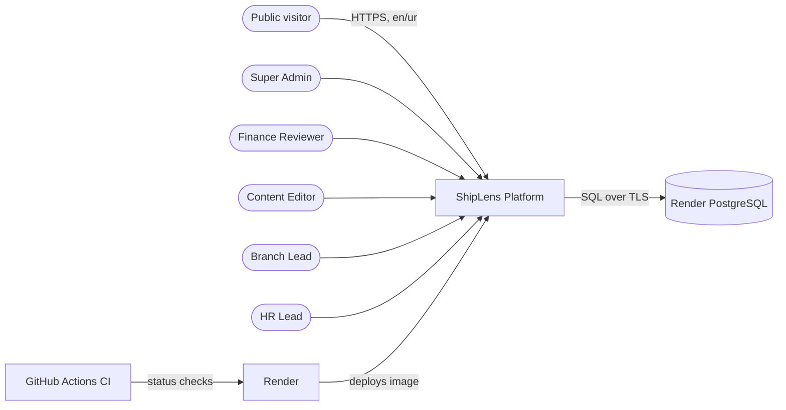
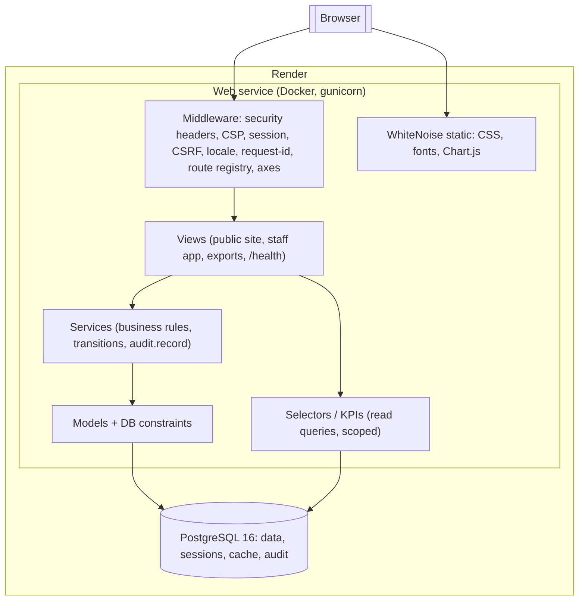

# 10 — Stack Decision and System Architecture

## 1. Stack comparison

Weights reflect a solo developer, a 9-day build, and the "explain every line" rule.

| Criterion (weight) | Django 5.2 LTS (Python) | Next.js 15 full-stack (TS) + Prisma + Auth.js | Laravel 11 (PHP) | NestJS + React SPA |
|---|---|---|---|---|
| Solo velocity / batteries (20) | **5** — auth, sessions, CSRF, forms, migrations, i18n, admin-free CRUD with generic views | 3 — assemble auth, forms, validation, i18n yourself | 4 — very batteries-included | 2 — two apps to build |
| Built-in auth & security defaults (12) | **5** — Argon2 hasher, CSRF, clickjacking, `check --deploy` | 3 — Auth.js credentials provider discouraged; CSRF manual for route handlers | 5 | 3 |
| RTL / i18n maturity (10) | **5** — gettext `.po`, `LANGUAGE_BIDI`, `i18n_patterns` | 4 — next-intl good | 4 | 3 |
| Urdu PDF shaping (10) | **5** — WeasyPrint uses Pango/HarfBuzz → correct Nastaliq/Naskh joining | 2 — pdfkit/react-pdf weak shaping; Puppeteer/Chromium heavy for 512 MB Render | 3 — dompdf poor Arabic shaping; needs mPDF | 2 |
| Lighthouse (SSR, minimal JS) (10) | **5** — server templates, ~0 JS on public pages | 4 — RSC good but JS bundle ships | 5 | 2 — SPA hurts SEO/perf |
| PostgreSQL migrations (6) | **5** — native | 4 — Prisma Migrate | 5 | 4 — TypeORM/Prisma |
| Testing & coverage tooling (8) | **5** — pytest-django, pytest-cov, transactional tests | 4 — Vitest + test DB setup | 4 — PHPUnit/Pest | 4 |
| Render deployability (Docker) (6) | 5 | 5 | 4 | 4 (two services) |
| CI simplicity (4) | 5 | 4 | 4 | 3 |
| Explainability to judges (14) | **5** — explicit views/forms/services, little magic, one language | 3 — server/client component boundaries, caching semantics hard to explain | 3 — facades/magic | 3 |
| **Weighted total (/500)** | **500** | 340 | 404 | 280 |

> Scores are my judgement for *this* project and *this* developer profile (Python-capable, solo, 9 days). Django scoring 5 everywhere is not a claim that it's perfect — it reflects that every criterion here is one of its known strengths. Its real weaknesses (less interactive UI, Python cold-start memory) don't carry weight in this brief.

### Recommendation (ADR-001): **Django 5.2 LTS + PostgreSQL 16, server-rendered templates, no SPA.**
- **Why:** highest security-by-default, best Urdu PDF story, fastest solo path, Lighthouse-friendly, and every request flows through code I can read top to bottom (URL → view → form → service → model → template).
- **Trade-off:** less "modern frontend" flair; interactive dashboard limited to Chart.js; if I am much stronger in TypeScript (Q-04), Next.js is the fallback and the PDF approach must change (Playwright-based HTML→PDF in a separate step), costing ~1 day.

## 2. Exact libraries (pin exact versions on day 1 in `requirements.txt` via `pip-tools`)

| Concern | Choice | Notes |
|---|---|---|
| Runtime | Python 3.12, Django 5.2 LTS | LTS until 2028 |
| DB driver | `psycopg[binary]` 3.x | |
| DB URL | `dj-database-url` | parses Render `DATABASE_URL` |
| ORM / migrations | Django ORM + migrations (`RunSQL` for triggers) | |
| Auth | `django.contrib.auth` custom User (email login) + `argon2-cffi` | |
| Login lockout | `django-axes` | 5 fails / 15 min |
| Rate limiting | `django-ratelimit` + `DatabaseCache` | works across gunicorn workers |
| Security headers | Django `SecurityMiddleware` + `django-csp` 4.x | nonce-free CSP: no inline scripts at all |
| Validation | Django Forms / ModelForms (whitelisted `fields`) | |
| HTML sanitising | `markdown` + `nh3` | CMS bodies |
| i18n | Django i18n (`gettext`, `.po/.mo`, `i18n_patterns`) | `polib` in tests for parity |
| PDF | `WeasyPrint` | needs `libpango-1.0-0 libpangoft2-1.0-0 libharfbuzz0b` in image |
| CSV | stdlib `csv` with `utf-8-sig` | |
| XLSX import | `openpyxl` | sample-data importer only |
| Charts | Chart.js 4 (vendored file, MIT) | dashboard only |
| CSS | hand-written CSS with custom properties + logical properties (~15 KB) | no framework |
| Static files | `whitenoise` (compressed manifest storage, brotli) | |
| App server | `gunicorn` (2 workers, `--timeout 60`) | |
| Testing | `pytest`, `pytest-django`, `pytest-cov`, `factory-boy`, `time-machine`, `pytest-playwright` (E2E), `axe-playwright-python` (a11y) | |
| Lint/format | `ruff` (lint + format, incl. `S` bandit rules, `DJ` rules, banned-api for `timezone.now`) | |
| Security scan | `pip-audit`, Dependabot, GitHub CodeQL (free for public repos) | |
| Perf | Lighthouse CI (`@lhci/cli` via `treosh/lighthouse-ci-action`) | |
| Pre-commit | `pre-commit` running ruff | |

Deliberately **not** used: Django REST Framework (no SPA/API consumer), Celery/Redis (no workers on free tier), django-fsm (transition tables are clearer), Tailwind/Bootstrap (node build, unused CSS), Django admin in production (bypasses services/audit).

## 3. C4 — Context



## 4. C4 — Containers



## 5. Module boundaries (Django apps)

```text
config/            settings (base, prod, test), urls, wsgi
apps/core/         clock, id_sequences, business_rules/settings, middleware (request id, route registry),
                   base views/mixins, health view, error views
apps/accounts/     User, roles, assignments, permissions.py (matrix + can() + scope_queryset), auth views
apps/audit/        AuditLog model, audit.record(), hash chain, viewer, verify command
apps/branches/     City, Branch, lifecycle service
apps/volunteers/   Application (public form), Member, Team, VolunteerRole, services
apps/finance/      Collection, Transfer, WeeklyReport(+Lines), REPORT_FIELDS registry, services
apps/dashboard/    kpis.py (pure functions), views
apps/exports/      csv/pdf renderers, export registry
apps/cms/          ContentItem, ContentTranslation, publish service, public site views
apps/seed/         seed_demo, import_sample_data, generate_weekly_drafts commands
templates/, static/, locale/{ur}/LC_MESSAGES/
tests/             mirrors apps; tests/e2e/
```

**Dependency rule:** `views → services/selectors → models`; services may call `audit` and `core`; no app imports another app's views. Cross-app calls go through the other app's `services.py`/`selectors.py` only.

## 6. Where cross-cutting concerns live

| Concern | Location | Mechanism |
|---|---|---|
| Authentication | `accounts` + Django session middleware | login view, axes backend |
| Authorisation (action) | `PermissionRequiredMixin.required_action` + service `require()` | matrix |
| Authorisation (scope) | `scope_queryset()` in every `get_queryset` and selector | branch ids |
| Route default-deny | `RouteRegistryMiddleware` | every url_name must be registered |
| Validation | Forms (shape) + services (business rules) + DB constraints (last line) | three layers |
| Auditing | `audit.record()` inside service transactions; auth signals for login/logout/failed | same transaction |
| Time | `core.clock` | patchable |
| Config | `core.rules.get("collection_lock_days")` → `system_settings` override → settings default | |
| i18n | locale middleware + `i18n_patterns` | |

## 7. Scheduler-free design (Render free tier)

| Need | Strategy |
|---|---|
| 7-day collection lock | **Computed** at read/write time from `created_at` — no job. |
| Weekly drafts | **Lazy, idempotent** `ensure_drafts(branch)` on Reports page/dashboard; unique constraint handles races; optional GitHub Actions `schedule:` workflow calling `POST /internal/generate-drafts` with a bearer token (OPT-06). |
| Report lock | Same transaction as approval. |
| Audit chain verify | On demand (SA button / command). |

## 8. Request lifecycle example — "Finance approves report"

1. `POST /en/app/reports/42/approve/` with CSRF token and `expected_revision=2`.
2. Middleware: session → user; route `report-approve` registered with action `report.approve`.
3. View mixin: `can(user, "report.approve")` → FR ✓. `get_object_or_404(scope_queryset(...), pk=42)`.
4. Service `reports.approve(actor, report_id, expected_revision)`: `transaction.atomic`, `select_for_update`, check state ∈ {SUBMITTED, RESUBMITTED} and revision, set APPROVED → `audit.record("report.approved")` → set LOCKED → `audit.record("report.locked")`.
5. Commit; redirect with toast; dashboard K2 reflects it on next load.

## 9. ADR list (to write in `docs/adr/`)

| ADR | Title |
|---|---|
| 001 | Django monolith with server-rendered templates |
| 002 | PostgreSQL constraints and triggers as last line of defence |
| 003 | Central RBAC matrix + scoped querysets (no Django groups/perms) |
| 004 | Audit log: same-transaction, append-only, hash-chained |
| 005 | Computed 7-day lock from `created_at`; no unlock |
| 006 | Lazy weekly-report drafting instead of cron |
| 007 | Snapshot + line items for submitted reports |
| 008 | Session cookies over JWT |
| 009 | Urdu font choice (Naskh) and WeasyPrint for PDFs |
| 010 | Render free/paid tier trade-offs and migrations-at-start |
| 011 | Transition tables instead of an FSM library |
| 012 | Counter table for human-readable IDs |
